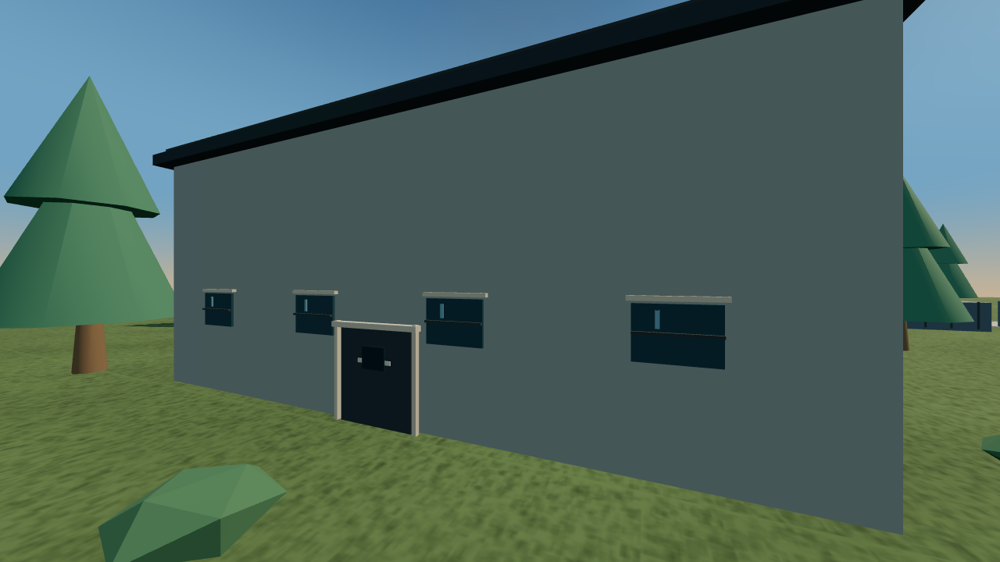
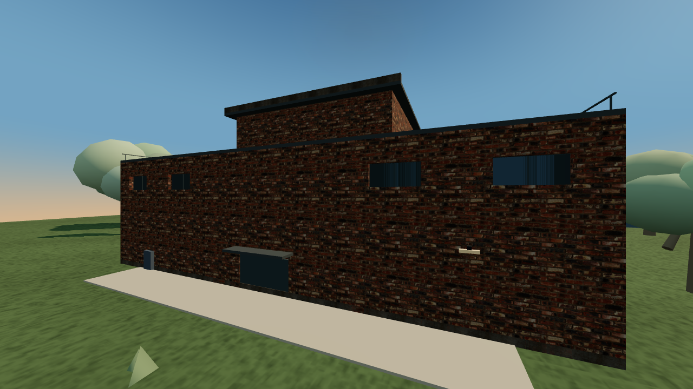
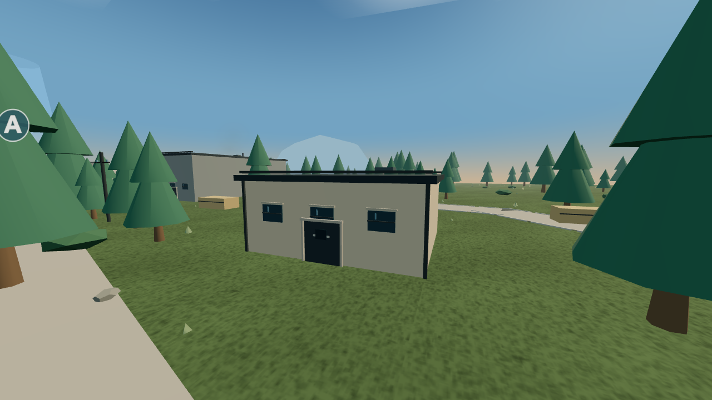
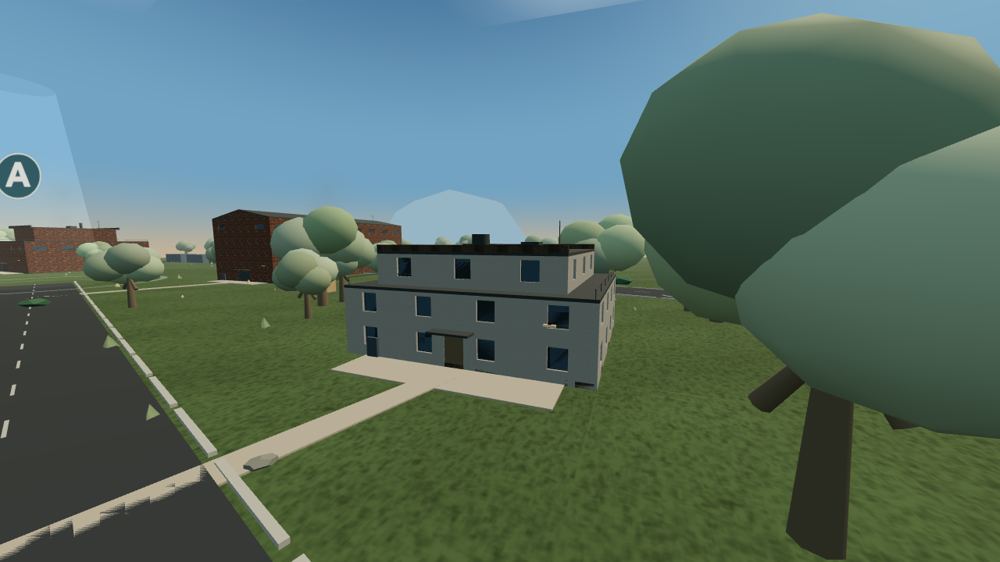
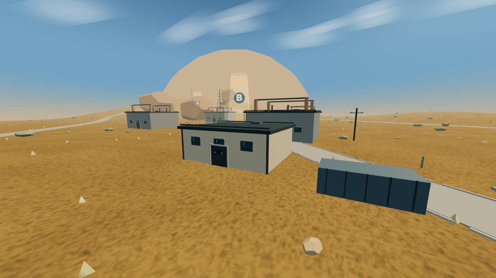
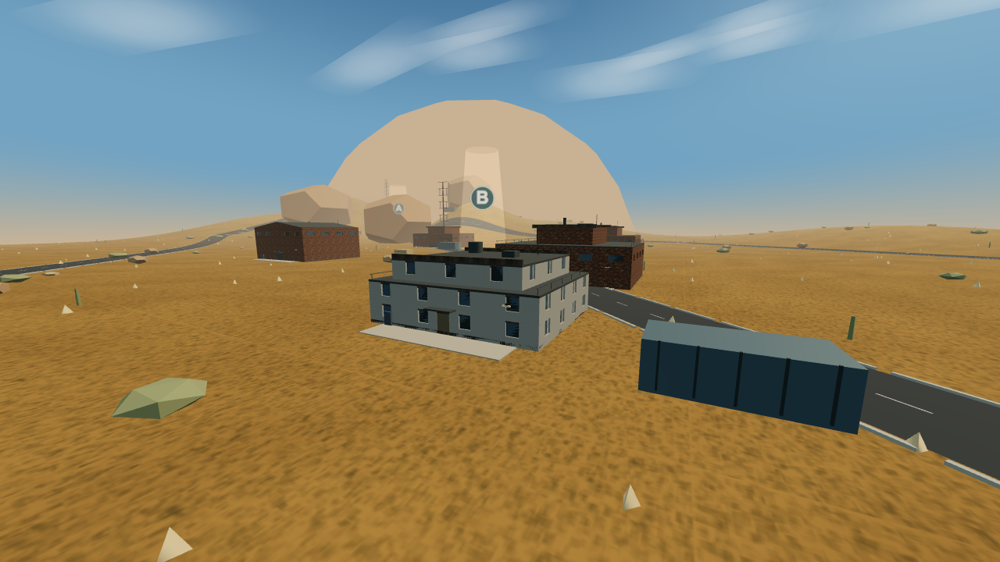

# IRONFRONT 0.20.0 建筑与环境开发报告

## 本轮范围

本轮在 GitHub main 的 0.19.0 基础上，升级现有 Three.js 与 TypeScript 网页项目至 0.20.0。重点是替换简单整块建筑与重复窗格，建立共享建筑结构、真实表面材质和可验证的碰撞契约，同时处理地图支援、喷气机机动、命中登记与 AI 聚集。收到建筑与城市环境不好看的反馈后，第一轮外观未作为最终方案，继续调整了退台、门窗凹进、屋顶、树冠和街道连接。

## 建筑结构

BuildingPlan 用建筑用途、坐标变体和合理层高生成住宅、办公楼、厂房、仓库和军事设施。住宅采用小尺度窗洞及部分退台；办公楼使用更宽的玻璃开间；厂房采用高位采光窗和服务核心；仓库有挤出山墙与坡屋顶。ModularBuildings 组合墙垛、窗间墙、玻璃、窗框、窗台、门框、雨棚、露台栏杆、排水管、空调、通风和天线，不再以一张整齐窗格覆盖整个盒子。建筑主体仍使用低成本规则几何，未导入高精度建筑 GLB。

## 材质与许可

导入 Poly Haven 的 brick_wall_001、plastered_wall、concrete_wall_006 三组 CC0 材质，每组包含 1K 色彩、OpenGL 法线和打包 AO Roughness Metalness 贴图，共九个 JPG，合计 6234347 字节。色彩贴图设 sRGB，数据贴图保持线性；砖墙采用约三米重复周期，其他表面约两米，按世界坐标投影避免大墙体把纹理拉伸。ARM 的红通道作为 AO，绿通道作为粗糙度；非金属墙不把蓝通道用作金属度。玻璃采用低粗糙度的不透明材质控制透明排序成本，当前只有灯光高光，没有专用实时反射探针。来源、许可、下载地址和 SHA256 位于 docs/licenses/ARCHITECTURE_TEXTURES_020.json。

## 街道与环境

道路沿既有 MapDefinition 主干线生成，原道路表面改为低反射深色沥青，附加道路标线与路缘。建筑门前有铺装与装在结构边缘的灯具、服务柜；入口在距离和通行条件允许时连接最近公共道路，连接线不会穿越已知建筑。工业地图的旧双层锥形树替换为带分枝的非透明实例树冠，并避开所有道路。沙漠地图去掉旧的重复屋顶梁柱和储罐装饰，避免与新屋顶结构叠加。完整城市密度、交通设施和地面杂物尚未全部制作。

## 碰撞与寻路

地图运行上下文将封闭建筑碰撞包络直接从相同 BuildingPlan 体量生成，退台不再按整块高墙处理。地面建筑占用仍沿用原布局，因此车辆通道及据点不因装饰而改变。Dust Horizon 新增一个有真实八米入口、侧墙、后墙和室内隔墙的地面房间；原工业地图保留三个可进入空间。步兵寻路在这些空间使用三米局部可见图，再通过入口连接原 A 星导航。每段路线校验墙体遮挡与玩家半径；车辆仍使用独立宽度的导航图。蹲伏和逐肢体命中尚未单独细分。当前导航仍是平面系统，未完成楼梯、多层作战和可到达屋顶，不把装饰栏杆写成可玩阳台。

## 性能结构

建筑以九十六米空间区域合并相同材质和几何的 InstancedMesh，保留区域级剔除。近距小装饰约一百八十米可见，整组约七百米可见；Three.js 视锥按实例包围球剔除。静态模块在创建地图时构建，运行只改变可见状态；不逐帧生成建筑 Geometry Material Texture。阴影仍使用围绕玩家的有限范围，低画质关闭阴影，小装饰不投影。退出战局遍历并释放所有材质贴图通道，支援飞机的缓存也有显式销毁。细节分级目前是关闭小模块和远距离整组，不是完整三档简化网格系统。

## 地图支援

玩家按 Q 选择实际支援后打开地图。点击位置显示范围，确认前不扣支援点；确认后服务端校验有限坐标和地图边界，再创建权威支援任务。轰炸任务记录四个命中点，飞机按服务端战局时钟飞过，实体炸弹按重力轨迹在实际伤害点落地；载具空投在选点附近检查可放置位置，保留召唤玩家的驾驶权。飞机视觉随 LAN 快照同步。支援飞机是任务表现对象，目前不能被击落；玩家可驾驶战斗机的现有玩法不被替换。

## 命中与飞行

修复玩家步枪命中登记只覆盖躯干以及漏算空中高度的问题，改用纵向球组覆盖躯干与头部，摄像机瞄准点与真实枪口射线重新对齐。已有三维遮挡成立后，不再用二维墙体检测把可见头部或高处命中重复拒绝。出生保护、同阵营、烟雾和真实墙体仍可阻止伤害。喷气机普通 A D 保持倾斜转弯，Shift 加力并按 A D 可持续滚转；直升机操作独立。低空通行检查实际建筑高度，取消统一二十八米以下禁止穿过任何平面障碍的假空气墙。边界和实物建筑碰撞仍保留。

## AI 分散与难度

小队左右和前后槽位放宽，友军避让半径扩大到四点五米；据点内使用固定个人扇区而不是所有人跑向中心。指挥官与原四兵种、医疗、维修及掩护交换保留。难度继续通过反应时间、误差、感知范围与同时攻击玩家的数量区分；本轮步兵伤害系数统一为零点五五，载具统一为零点六五，不再随难度增加单发威力。个人战斗位置仍可能因路线和掩体不足形成拥堵，这次测试不能证明达到商业特战 AI 水准。

## 剩余问题

仍未完成多层楼梯导航、真正可进入的屋顶阳台、完整城市街区密度、道路交通设施、专用实时玻璃反射，以及支援机被拦截。建筑和植被仍为规则低多边形，不能称作现代商业 FPS 同等画质。装饰屋顶的精确斜面物理未实现，主碰撞采用体量包络；后续需升级三维碰撞与导航再扩展垂直空间。自动战局结束不等于 AI 没有失败或对战平衡已完成。LAN 只验证本机服务与多客户端，真实两设备网络隔离、Wi Fi 和防火墙未验证。帧时间为短时固定机位采样，不能代表长期战斗或其他 GPU。

## 运行与分发

完整本地包包含十一首用户提供 MP3 与二十九个音效；音乐仅在本机与下载包内。公开 GitHub 与源码 ZIP 不包含任何 MP3，只保留既有导入清单。安装 Node 后 npm install，单人运行 npm run dev；LAN 运行 npm run lan，默认端口 7878，其他玩家浏览器访问房主局域网地址。此次提交直接更新 main，交付前再次 fetch 核对，保留既有远端提交。

## 实际前后对照

### factory-detail

升级前：

升级后：

### industrial-frontier

升级前：

升级后：

### dust-horizon

升级前：

升级后：

检查、性能与边界见 [QA_REPORT](../QA_REPORT.md)，详细 Word 报告见 [DEVELOPMENT_020.docx](DEVELOPMENT_020.docx)。
